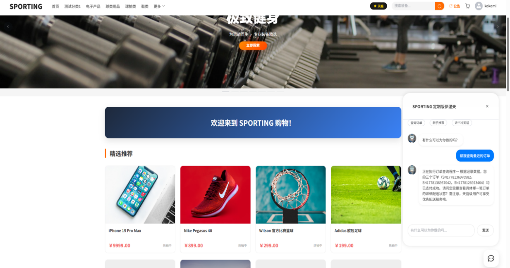
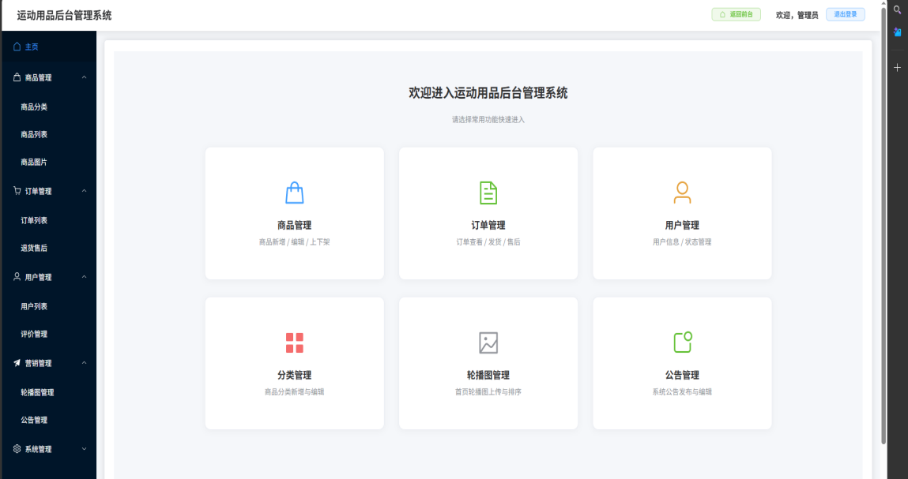
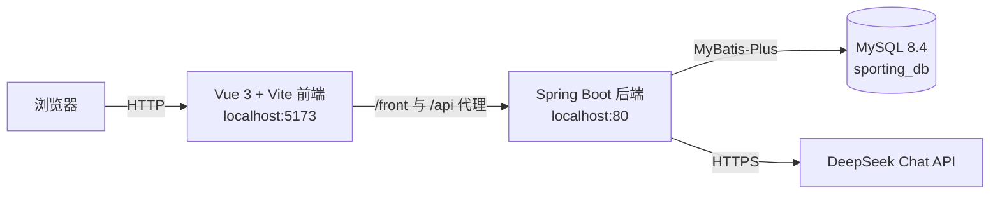

# SPORTING 体育用品销售网站

> 基于 Spring Boot + Vue 3 的前后端分离体育用品电商系统，本科毕业设计作品。
> 仓库内的论文、截图和演示视频已完成个人信息脱敏，代码中的 DeepSeek 密钥已移除。
> 教学视频约 4.49GB，未放入主仓库，AI时代让AI自己学习。


## 项目简介

SPORTING 是一个面向中小型体育用品商家的 B2C 电商网站，采用前后端分离架构：

- **前台**：商品浏览/搜索、购物车、收货地址、下单支付、订单与售后、评价收藏、会员成长体系、AI 智能客服。
- **后台**：商品/分类/轮播图/公告管理、订单与退换货审核、用户与管理员管理、评价管理。
- **AI 客服**：接入 DeepSeek Chat API，把当前用户的订单和推荐商品作为上下文写入 System Prompt，实现订单查询、商品推荐和日常咨询。

论文题目：**基于 Spring Boot 的体育用品销售网站的设计与实现**。

## 界面预览

| 前台首页 | 后台首页 |
| --- | --- |
|  |  |

## 功能清单

### 前台商城

- 用户注册、登录、退出，Session 会话保持
- 首页轮播图、公告、分类导航、精选商品
- 商品列表、分类筛选、关键词搜索、价格排序、商品详情
- 购物车增删改查、库存校验
- 收货地址管理、默认地址
- 订单预览、提交订单、模拟支付（支付宝/微信二维码占位）
- 订单列表/详情、确认收货、退换货申请
- 商品评价、收藏
- 15 阶会员成长体系（经验值、等级、折扣、VIP）
- AI 智能客服（DeepSeek）

### 后台管理

- 管理员登录、后台首页数据看板
- 商品管理：新增、编辑、上下架、库存调整、图片上传
- 商品分类管理
- 轮播图管理
- 公告管理
- 订单管理：查询、删除、发货/状态流转
- 退换货审核：通过/驳回
- 用户管理：查询、删除
- 管理员管理
- 评价管理

## 技术栈

| 层次 | 技术 | 版本 |
| --- | --- | --- |
| 后端语言 | Java | 17（本地 17.0.8） |
| 后端框架 | Spring Boot | 4.0.0 |
| 持久层 | MyBatis-Plus | 3.5.15 |
| 数据库 | MySQL | 8.4.0 |
| 连接池 | Druid | 1.2.23 |
| 构建工具 | Maven Wrapper | 3.9.11 |
| 工具库 | Lombok / Hutool | 1.18.36 / 5.8.28 |
| 前端框架 | Vue | 3.5.24 |
| 构建工具 | Vite（rolldown-vite） | 7.2.5 |
| UI 组件 | Element Plus | 2.13.0 |
| HTTP 客户端 | Axios | 1.13.2 |
| 路由 | Vue Router | 4.0.13 |
| 日期库 | date-fns | 4.1.0 |
| 运行环境 | Node.js / npm | Node ≥ 22（本地 25.2.1）/ npm 11.6.2 |
| AI | DeepSeek Chat API | `deepseek-chat` |

更完整的工具版本与教学视频说明见 [docs/tools.md](docs/tools.md)。

## 系统架构



## 项目结构

```text
sporting-mall/
├─ backend/                 Spring Boot 后端（Maven）
│  ├─ src/main/java/        Controller / Service / Mapper / Entity
│  ├─ src/main/resources/   application.yml、Mapper XML
│  └─ pom.xml
├─ frontend/                Vue 3 + Vite 前端
│  ├─ src/pages/            前台与后台页面
│  ├─ src/components/       公共组件
│  ├─ src/router/           路由
│  └─ package.json
├─ database/
│  └─ sporting_db.sql       建库建表与演示数据
├─ docs/
│  ├─ thesis/               脱敏版论文 PDF / DOCX
│  ├─ images/               README 截图
│  └─ tools.md              开发工具与版本说明
├─ demo/
│  └─ demo.mp4              功能演示视频（已剪去含密钥的代码片段）
├─ LICENSE
└─ README.md
```

## 快速开始

### 1. 环境要求

- JDK 17
- MySQL 8.0+（建议 8.4）
- Node.js 22+ 与 npm
- 可选：IntelliJ IDEA 2024、VS Code、Navicat

### 2. 初始化数据库

```bash
mysql -uroot -p < database/sporting_db.sql
```

脚本会创建 `sporting_db` 数据库，并写入演示商品、订单、用户和管理员数据。

### 3. 启动后端

```bash
cd backend
```

Windows PowerShell：

```powershell
$env:DB_PASSWORD="123456"
$env:DEEPSEEK_API_KEY="sk-your-deepseek-key"
.\mvnw.cmd spring-boot:run
```

macOS / Linux：

```bash
export DB_PASSWORD=123456
export DEEPSEEK_API_KEY=sk-your-deepseek-key
./mvnw spring-boot:run
```

后端默认端口为 `80`。如端口被占用，可设置 `SERVER_PORT=8080`，同时把 `frontend/vite.config.js` 中的代理目标改为 `http://localhost:8080`。

### 4. 启动前端

```bash
cd frontend
npm install
npm run dev
```

浏览器打开 <http://localhost:5173>。

### 5. 配置 DeepSeek（可选）

AI 客服由后端读取以下环境变量：

| 变量 | 必填 | 说明 |
| --- | --- | --- |
| `DEEPSEEK_API_KEY` | 是（使用 AI 时） | DeepSeek API Key，**不要写入代码或提交到 Git** |
| `DEEPSEEK_API_URL` | 否 | 默认 `https://api.deepseek.com/chat/completions` |
| `DEEPSEEK_MODEL` | 否 | 默认 `deepseek-chat` |

未配置 Key 时，商城其他功能正常运行，AI 客服会返回“尚未配置”的提示。

## 演示账号

| 角色 | 账号 | 密码 | 入口 |
| --- | --- | --- | --- |
| 后台管理员 | `admin` | `123456` | `/admin/login` |
| 前台用户 | `zhangsan` | `123456` | `/login` |
| 前台用户 | `lisi` | `123456` | `/login` |

> 以上均为演示数据，密码以明文形式存放在 SQL 中，仅用于本地运行，**请勿用于生产环境**。

## 主要接口

| 模块 | 前缀 | 说明 |
| --- | --- | --- |
| 前台用户 | `/front/user` | 登录、注册、用户信息 |
| 前台商品 | `/front/product` | 商品列表、详情 |
| 前台购物车 | `/front/cart` | 购物车 CRUD |
| 前台订单 | `/front/order` | 预览、提交、列表、详情 |
| 前台售后 | `/front/return` | 退换货申请与查询 |
| 前台 AI | `/front/ai` | DeepSeek 智能客服 |
| 后台商品 | `/api/product` | 商品管理 |
| 后台订单 | `/api/order/admin` | 订单管理 |
| 后台用户 | `/api/user` | 用户管理 |
| 后台管理员 | `/api/manager` | 管理员管理 |

## 脱敏与安全说明

本仓库在公开前做了以下处理：

- 删除代码中硬编码的 DeepSeek API Key，改为 `DEEPSEEK_API_KEY` 环境变量注入。
- 论文封面中的学校、姓名、学号、班级、指导教师替换为 `XX大学`、`某某`、`2022XXXXXXXX`、`某老师`。
- 清理 Word/PDF 文档属性中的作者、最后修改者和 WPS 用户标识。
- 论文截图中出现真实姓名的轮播图文字、支付二维码已做遮挡/替换。
- 演示视频剪去了展示 IDE 中 API Key 的片段（原视频 34–62 秒）。
- 前台页脚中的个人邮箱、电话、家庭地址已替换为占位信息。
- 数据库中的演示手机号、邮箱均为虚构数据；轮播图标题中的姓名已移除。
- 未上传中期检查、指导记录、查重报告、答辩手册等含个人信息的行政材料。

> 这是一个教学/毕业设计项目，后台鉴权仅为前端路由守卫和简单 Session 校验，未接入 Spring Security/JWT，也没有做完整的越权防护。请勿直接部署到公网生产环境。

## 已知限制

- 支付为模拟流程，未接入真实支付宝/微信支付。
- 后台管理接口未做服务端权限校验，生产环境需要补 Spring Security + JWT/RBAC。
- 用户密码为明文存储，生产环境应改为 BCrypt/Argon2 哈希。
- AI 客服的订单上下文来自当前用户，但接口仍建议增加服务端身份校验与限流。
- 论文正文写作时部分章节按 Spring Boot 3.x 表述，仓库代码以 `pom.xml` 中的 Spring Boot 4.0.0 为准。

## 文档

- [毕业设计论文（脱敏版 PDF）](docs/thesis/毕业设计论文-脱敏版.pdf)
- [毕业设计论文（脱敏版 DOCX）](docs/thesis/毕业设计论文-脱敏版.docx)
- [开发工具与版本说明](docs/tools.md)
- [功能演示视频](demo/demo.mp4)

## License

代码采用 [MIT License](LICENSE)。论文、截图、演示视频的著作权归作者所有，仅用于学习交流；第三方图片、商标、字体等归各自权利人所有，详见 [NOTICE.md](NOTICE.md)。
